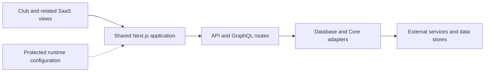

# Shared CRAYS web application

This directory preserves the qualified shared Next.js composition used to prepare the Club source24 build input. The tree contains multilingual Club pages, Member/SaaS views, investment/franchise routes, API and GraphQL handlers, and database/Core adapters.

The source selection contains **2,045 original files**, including five existing integration files. Two source tags preserve the baseline input view and the separately declared one-line Club-pool overlay:

| Source view | Immutable capture tag |
| --- | --- |
| Baseline selection with the original pool-file preimage | shared-web-source-baseline-20261108 |
| Prepared source24 selection with the declared overlay | shared-web-source-state24-20261108 |

These are source-capture tags. The recorded baseline BUILD_ID is MKqk1B-xeW6DX8QPKUAfx; it is a historical reference, not proof that either capture was rebuilt or newly deployed. The exact selected bytes and capture scope are listed in [source-capture.json](source-capture.json).

## Structure and relationships

| Location | Contents |
| --- | --- |
| src/app | Public pages, SaaS views, API routes and original preserved route variants |
| src/components | UI components and public site copy |
| src/graphql | Original schema/operation inputs and generated persisted-operation records |
| src/db and src/lib | Database, identity, commerce and application adapters |
| runtime-integration | Five unchanged original integration files |
| third-party | Version-specific package metadata, original notices and unresolved notice questions |
| provenance | Source review, dependency observations, borrowed lock records and recovery gaps |
| configuration | Environment-variable names observed directly in the captured code |

The earlier shared subtree remains in the original crays-gym repository at commit 0dd822d7578dfffd55ff76eb8f37ae4c5f6f99ed. The recorded comparison found 593 identical path/body pairs, 24 changed files at matching paths and 1,428 new paths. This import preserves the qualified later selection; the complete earlier mixed product history and other WIP remain separate reconciliation work.

[Platform overview](../../README.md) describes the other services and operations sources. Independent Coffee, Shop and Pro implementations remain in their own repositories. Product/version references identify the applicable shared composition.

## Development and recovery

Restore the exact dependency, asset, runtime and protected-configuration inputs before attempting a build. [Recovery prerequisites](docs/recovery.md) distinguish available source from missing inputs.

The original package build script is:

    npm run build

It invokes Next.js with the original webpack option. No install, application test, build, database script or deployment was executed for this capture. The Node runtime version is not established by the retained source metadata.

The original package also references 94 distinct operational helper paths that are absent from this selected source and recorded baseline release. [Recovery gaps](provenance/recovery-gaps.json) retain those references. Those package scripts are not supplied as operational recovery instructions.

[.env.example](.env.example) contains empty values for directly observed variable names. Dynamic lookups and original runtime policies may require additional configuration. Credentials and protected data are supplied separately.

## Licenses and provenance

[Dependency notices](third-party/README.md) retain original root notice texts located for 45 of the 47 directly declared packages. The captured application package has no license field, and no application-level license text was found in the examined source-selection and baseline roots. Application authorship/rights records, transitive and bundled dependencies, runtime notices and applicable source-availability obligations remain open.

Original code, copyright and notice text is preserved. See [license status](LICENSE-STATUS.md) for the exact remaining questions.

Original .orig/.rej/.tmp and disabled-route files remain in the captured tree as historical/WIP inputs. Original source and notice formatting is retained byte for byte; the source capture does not assert that every preserved WIP file is an active build input.

## Operational source

The [original scripts](scripts/README.md) retain 90 referenced operational programs and two imported helpers with exact baseline/worktree tags. Four referenced programs and remaining execution datasets/documents are still under review. The separate [helper manifest](provenance/operational-helpers.json) distinguishes their source history from the 2,045-file application capture and current AWS runtime.

## Exact Member source variants

The [Member composition export](compositions/member-source25/README.md) preserves the 1,399-file original Member input and the 1,401-file AWS build input without replacing the prepared shared application tree. Unchanged source is referenced by immutable Git commit; changed source bodies and protected templates are retained with exact manifests. Both views passed full original-byte reconstruction checks. See the [Member source/build/dependency binding](provenance/member-source25/README.md) for the recorded build, original project lock and existing notice catalog.
