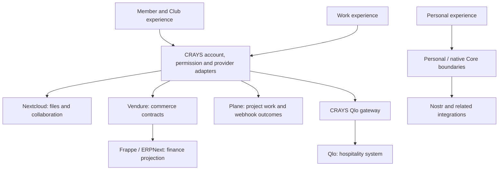

# How CRAYS fits together

CRAYS is building the software connecting members, guests and venue operators across community and hospitality projects. Its architecture brings together personal experiences, membership and operational work. Understanding these responsibilities makes it easier to choose a component and contribute a change without mixing unrelated account, data or deployment boundaries.

## Three related experiences

**Personal** contains the individual's frontend experience and captured views for areas such as social activity, documents and training. The preserved React/Vite source is under [apps/personal](../apps/personal/README.md). Personal/Chuck backend and agent integrations have their own service boundaries; the frontend capture alone does not contain all of them.

**Member** connects membership, identity and provider-backed activities. The [shared web application](../apps/web/README.md) and [separate Club/Member browser module](../modules/club-member/README.md) are different builds. Account and session contracts determine which original identity is being represented.

**Work** connects operational workflows to systems such as ERPNext, Plane, Qlo and commerce providers. Work captures and runtime revisions are source versions of this area, rather than separate products.

## Target architecture: APIs, Core/BCC and independent services

**Target architecture · AWS integration in progress.** The following views describe the agreed responsibilities and migration direction. They do not assert completed provider connections, database cutovers or customer acceptance. Core/BCC is the shared layer for identity, accounts, authorization and business rules. Application-specific backends-for-frontends (BFFs) have a separate role.

### Access and business authority

~~~mermaid
flowchart TD
    Person["Person using web or native application"] --> API["CRAYS API / GraphQL operation"]
    API --> Identity["Core / BCC: identity and account"]
    Identity --> Rules["Permissions, tenant scope and business rules"]
    Rules --> Adapter["Application BFF / provider adapter"]
    Adapter --> Provider["Provider API and its own access checks"]
    classDef crays fill:#fff1f2,stroke:#b42335,color:#202124;
    class API,Identity,Rules,Adapter crays;
~~~

The application requests a defined operation. Core/BCC supplies account and business authority; the adapter carries the appropriate scope to the service. Provider credentials and access checks remain separate. The [Member GraphQL transport](../services/member-club/source50/README.md) provides a concrete route/operation boundary, while the [Commerce BFF](../services/clubs-commerce-bff/README.md) shapes browser requests and safe responses. Neither is proof that every provider implements GraphQL.

### Independent service responsibilities

~~~mermaid
flowchart TD
    Core["Core / BCC and CRAYS service adapters"] --> Projects["Plane: projects"]
    Core --> Commerce["Vendure: commerce"]
    Core --> Finance["Frappe / ERPNext: business and finance"]
    Core --> Hotel["Qlo: hospitality"]
    Core --> Cloud["Nextcloud: files and collaboration"]
    Core --> Publishing["Postiz: publishing delivery"]
    Core --> Chuck["Chuck: consumer, agent and workflow integration"]
    Chuck -. "documented component relationship" .-> OpenClaw["OpenClaw agent components"]
    classDef crays fill:#fff1f2,stroke:#b42335,color:#202124;
    class Core,Chuck crays;
~~~

Each named service retains its own API, runtime and domain responsibilities. A cross-service workflow needs explicit correlation and outcome reconciliation. Vendure order/payment state, Booking Core holds/bookings/capacity and ERPNext accounting remain different authorities. Personal is the application experience; Chuck is the broader personal-intelligence integration; OpenClaw is a documented upstream component family, not a synonym for either. The [service catalog](services/README.md) links their implementations and limits. Twenty is [archived and no longer used](https://github.com/CraysWorld/.github/blob/main/docs/legacy-projects.md); its appearance in a broader service concept does not establish a current or reintroduced CRM provider.

### Example journey: a member order and its accounting consequence

**Illustrative target journey · source contracts exist; this is not a live checkout or accounting acceptance claim.** This view follows one business action across the boundaries above. It separates the commerce result shown to the member from the later accounting consequence.

~~~mermaid
flowchart TD
    Member["Member requests an order"] --> Authority["Core / BCC: identity, account and business authorization"]
    Authority --> BFF["Commerce BFF: validate request and coordinate the order command"]
    BFF --> Vendure["Vendure: commerce order / payment state"]
    Vendure --> View["Application shows the commerce outcome"]
    Vendure -. "intended accounting consequence" .-> Delivery["CRAYS projection / delivery contract: tenant, company and event correlation"]
    Delivery --> ERP["Frappe / ERPNext adapter: dispatch the scoped consequence"]
    ERP --> Accounting["ERP outcome: confirmed, failed or still unknown"]
    classDef crays fill:#fff1f2,stroke:#b42335,color:#202124;
    class Authority,BFF,Delivery,ERP crays;
~~~

In plain terms: authorize the action, ask the commerce provider, then account for the result through a separately scoped delivery. An order result, a queued consequence and a confirmed ERP result are different records. An unknown accounting result needs reconciliation; the interface must not turn it into a completed accounting claim. Booking Core separately owns holds, bookings and capacity when the operation involves them.

Follow the [Commerce BFF](../services/clubs-commerce-bff/README.md), [commerce guide](services/commerce.md) and [Frappe / ERPNext workflow](services/frappe.md#understand-the-workflow). Their source records retain test-only inventory, disabled live-money movement and deferred ERP dispatch in the cited snapshots. The diagram explains responsibilities, not a claim that those restrictions have been lifted.

### Storage and the PostgreSQL migration

~~~mermaid
flowchart LR
    Neon["Neon PostgreSQL: prior Core store"] -. "migration direction" .-> RDS["Amazon RDS PostgreSQL: Core store"]
    Core["Core / BCC"] --> RDS
    Services["Independent services"] --> PG["Service-owned PostgreSQL"]
    Services --> MySQL["MySQL / MariaDB where required"]
    Files["File / object-storage integrations"] --> S3["Amazon S3"]
    Files --> ProviderFiles["Provider-specific file services"]
    classDef crays fill:#fff1f2,stroke:#b42335,color:#202124;
    class Core,Files crays;
~~~

RDS replaces Neon PostgreSQL in the Core storage role; it does not replace GraphQL or require every service to use PostgreSQL. Service-specific MySQL/MariaDB remains appropriate where required. S3 has an additional file/object-storage role, without implying that every Nextcloud file or provider database has moved there. These diagrams define boundaries; exact selected versions, source recovery and live migration acceptance need their own evidence.

## Connections between the layers

The diagram describes source responsibilities and integration directions. It is not a claim that every edge is currently accepted for customer use.

The [service hub](services/README.md) gives each of these areas one clear entry point. Its service pages distinguish upstream functionality from CRAYS-specific code and link to the actual adapters and contracts.

## What CRAYS implements

The integration layer is more than a collection of upstream links. Published source includes:

- Account/session mapping and explicit access boundaries for Member and native/browser clients.
- Nextcloud document-provider and collaboration-access adapters.
- Commerce event contracts, ERP projection and outcome reconciliation.
- Plane work-item delivery, webhook validation and projection contracts.
- A Qlo gateway, source tests and Work runtime modules.
- Shared web applications, Personal views, the independently built Club/Member module and retained native projects.

These responsibilities live in separate source areas because they have different consumers, build requirements and provider assumptions. The individual READMEs are the authority for selecting a source view.

## Code and documentation map

| Location | Responsibility |
| --- | --- |
| [apps/web](../apps/web/README.md) | Shared Next.js application and named source compositions. |
| [apps/personal](../apps/personal/README.md) | Captured Personal React/Vite frontend and its source views. |
| [modules/club-member](../modules/club-member/README.md) | Independently built browser module. |
| [services](../services) | Gateway, BFF and runtime implementation components. |
| [docs/services](services/README.md) | Canonical service explanations, code entry points and contribution directions. |
| [operations](../operations/README.md) | Build, migration and operating-program source with original preconditions. |
| [source index](source-index.json) | Exact source captures, immutable references and version records. |

Independent websites and native applications keep their own repositories. The [organization map](https://github.com/CraysWorld/.github/blob/main/docs/repository-structure.md) explains those boundaries.

## Identity, data and upstream ownership

An account binding is not a permission grant to every provider. Provider credentials, company scopes, document ownership and webhook authority remain separate concerns. Contributors should use synthetic identities and provider substitutes when testing a single component.

CRAYS-specific adapters do not replace the upstream systems' source, authorship or licenses. A Calendar fork, for example, is not the complete Nextcloud server. The service guides link upstream projects separately from CRAYS code and identify incomplete source/version relationships.

## Choose a development path

For frontend work, choose the appropriate application or module and read its source-view instructions. For an integration, start from the service guide and its contract tests. For documentation, verify each linked path and describe only behavior supported by the current code.

Continue with [Contributing](../CONTRIBUTING.md), [development and releases](development-and-releases.md) and the selected component's README. Current source/version and original-notice details remain in [the technical catalog](source-index.json) and [license/provenance guide](license-and-provenance.md).
