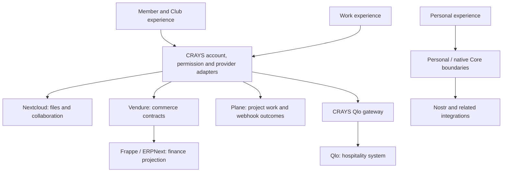

# How CRAYS fits together

CRAYS is building the software connecting members, guests and venue operators across community and hospitality projects. Its architecture brings together personal experiences, membership and operational work. Understanding these responsibilities makes it easier to choose a component and contribute a change without mixing unrelated account, data or deployment boundaries.

## Three related experiences

**Personal** contains the individual's frontend experience and captured views for areas such as social activity, documents and training. The preserved React/Vite source is under [apps/personal](../apps/personal/README.md). Personal/Chuck backend and agent integrations have their own service boundaries; the frontend capture alone does not contain all of them.

**Member** connects membership, identity and provider-backed activities. The [shared web application](../apps/web/README.md) and [separate Club/Member browser module](../modules/club-member/README.md) are different builds. Account and session contracts determine which original identity is being represented.

**Work** connects operational workflows to systems such as ERPNext, Plane, Qlo and commerce providers. Work captures and runtime revisions are source versions of this area, rather than separate products.

## Connections between the layers

The diagram describes source responsibilities and integration directions. It is not a claim that every edge is currently accepted for customer use.

The [service hub](services/README.md) gives each of these areas one clear entry point. Its service pages distinguish upstream functionality from CRAYS-specific code and link to the actual adapters and contracts.

## What CRAYS implements

The integration layer is more than a collection of upstream links. Published source includes:

- Account/session mapping and explicit access boundaries for Member and native/browser clients.
- Nextcloud document-provider and collaboration-access adapters.
- Commerce event contracts, ERP projection and outcome reconciliation.
- Plane work-item delivery, webhook validation and projection contracts.
- A Qlo gateway, source tests and Work runtime modules.
- Shared web applications, Personal views, the independently built Club/Member module and retained native projects.

These responsibilities live in separate source areas because they have different consumers, build requirements and provider assumptions. The individual READMEs are the authority for selecting a source view.

## Code and documentation map

| Location | Responsibility |
| --- | --- |
| [apps/web](../apps/web/README.md) | Shared Next.js application and named source compositions. |
| [apps/personal](../apps/personal/README.md) | Captured Personal React/Vite frontend and its source views. |
| [modules/club-member](../modules/club-member/README.md) | Independently built browser module. |
| [services](../services) | Gateway, BFF and runtime implementation components. |
| [docs/services](services/README.md) | Canonical service explanations, code entry points and contribution directions. |
| [operations](../operations/README.md) | Build, migration and operating-program source with original preconditions. |
| [source index](source-index.json) | Exact source captures, immutable references and version records. |

Independent websites and native applications keep their own repositories. The [organization map](https://github.com/CraysWorld/.github/blob/main/docs/repository-structure.md) explains those boundaries.

## Identity, data and upstream ownership

An account binding is not a permission grant to every provider. Provider credentials, company scopes, document ownership and webhook authority remain separate concerns. Contributors should use synthetic identities and provider substitutes when testing a single component.

CRAYS-specific adapters do not replace the upstream systems' source, authorship or licenses. A Calendar fork, for example, is not the complete Nextcloud server. The service guides link upstream projects separately from CRAYS code and identify incomplete source/version relationships.

## Choose a development path

For frontend work, choose the appropriate application or module and read its source-view instructions. For an integration, start from the service guide and its contract tests. For documentation, verify each linked path and describe only behavior supported by the current code.

Continue with [Contributing](../CONTRIBUTING.md), [development and releases](development-and-releases.md) and the selected component's README. Current source/version and original-notice details remain in [the technical catalog](source-index.json) and [license/provenance guide](license-and-provenance.md).
