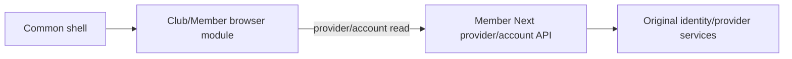

# Club/Member browser module

This browser module is built separately for the Common shell. It is distinct from the Next application/backend under apps/web. The original club-member-photo-contrast candidate has no own package.json or project lockfile.

| Source view | Inputs |
| --- | --- |
| original | All 133 original inputs: 129 application sources plus original configuration, build helper and dependency metadata. |
| origin35 | The same inputs with the exact two-line origin correction in candidate/src/integration/original-platform-identity.ts. |

The [build binding](build-binding.json) records module version club-member-7e7915d4e15c66b1. All 129 source hashes match the owner's successful build manifest. Runtime adoption and current cross-service acceptance are separate.

## Recover an exact source view

original/ retains the capture layout; postimages/origin35/ retains the one corrected file. The two manifests select a complete view. Nine sources are templates for the same fixed test-account input, whose public-demo status remains unresolved. The original input has a verified encrypted off-server backup and is supplied through the owner's protected recovery channel; it is not added to this public export.

With Python 3.9 or newer, restore to a new directory outside Git:

    python3 modules/club-member/restore_source.py --version origin35 --bindings-file /protected/member-source-bindings.json --destination /outside-git/club-member-source

Use --version original for the unpatched view. The destination parent must exist. All original hashes and byte counts are checked before output is written with owner-only permissions. Both 133-file views were restored: all 266 original comparisons passed. Missing/wrong input, existing output, output inside Git/the archive and a symlinked parent were refused without new output. The tool does not execute the application or original build helpers.

## Dependencies and original notices

The [dependency index](third-party/index.json) records 29 observed roots and 28 package versions, including nested duplicate picomatch roots. Original package metadata and 28 original notice/attribution files are retained. TypeScript's ThirdPartyNoticeText.txt was already byte-identical in the shared web catalog and is also retained for this module's exact dependency view.

The package/lock under original/dependency-metadata describe the original dependency environment. They are not a new module project manifest or install contract. Exact dependency-file hashes are retained; dependency implementations and native compiler binaries were captured separately by the owner and are not mirrored by this notice record.

The exact @rolldown/binding-linux-x64-gnu 1.1.5 archive and its publisher source commit are now associated with the original upstream root LICENSE and THIRD-PARTY-LICENSE in [the native binding notice record](third-party/packages/@rolldown/binding-linux-x64-gnu/1.1.5/upstream-source-and-notices.json). The existing byte-identical root LICENSE is reused at an immutable commit; the additional original attribution text is retained without modification. Full native/transitive/runtime sources and notices, original media/assets, application authorship rights and applicable source offers remain open. No generic license is substituted for an unestablished original.

## Build and operating source

The original build helper remains in the input capture. Source capture/build/stage/adoption controllers are archived separately under operations/member-origin35 with their original paths and preconditions. Publication does not execute or authorize them. This task did not repeat the successful owner build or change any runtime.

Common-shell/backend integration, current images and full protected operating recovery are separate. Original code and notices are preserved; no blanket application license or complete legal acceptance is inferred.

## Source-level component relationship

This describes source responsibilities; current cross-service runtime acceptance remains separate. The [anonymous GitHub readback](github-readback.json) confirms all 222 published file blobs and both complete restored source views.
